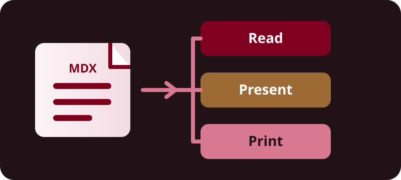

export const title = 'Slide-uri pentru website: demonstrație de funcționalități'
export const slug = 'website-slides-demo'
export const description = 'Un singur deck MDX, trei vizualizări redate pe server și un runtime de prezentare opțional.'
export const tags = ['topics:frontend', 'lang:typescript', 'tool:react']
export const createdAt = '19.10.2026'
export const modifiedAt = '19.10.2026'

# !!slide Bun venit la slide-urile website-ului

Un deck nativ burgundy, creat în MDX. **Read** este vizualizarea canonică pentru lectură, **Present** adaugă navigare la cerere, iar **Print** este un material static pentru tipărire din browser.

| Vizualizare | Potrivită pentru |
| --- | --- |
| Read | Linkuri și lectură atentă |
| Present | O prezentare live |
| Print | Print sau Save as PDF în browser |

## !notes

Începe cu Read: același conținut este deja util înainte de încărcarea JavaScript-ului de prezentare.

# !!slide O sursă, trei vizualizări

<SlideDiagram chart={'graph LR\nA[MDX source] --> B[Server rendering]\nB --> C[Read]\nB --> D[Present]\nB --> E[Print]'} label='Website-ul redă o singură sursă MDX în vizualizările Read, Present și Print.' />

Compilatorul, evidențierea sintaxei și diagramele rămân pe server. Numai Present activează comportamentul `reveal.js`.

## !notes

Subliniază că Present îmbunătățește secțiuni deja redate pe server; nu compilează Markdown în browser.

# !!slide Markdown și MDX

## Structură obișnuită de document

[Website-ul](/) folosește titluri și linkuri normale, iar acest tabel mic rămâne lizibil în fiecare vizualizare.

| Autor | Rezultat |
| --- | --- |
| Markdown | Structură și linkuri |
| MDX | Componente intenționate |



## !notes

Imaginea este un SVG local creat pentru acest conținut, nu un export de prezentare generat.

# !!slide Adnotări CodeHike

Numele fișierului, numerele de linie, marcajele, diferențele și pliurile rămân dovezi utile și statice în Read și Print.

```ts slide-policy.ts
export function chooseView(requested: 'read' | 'present' | 'print') {
  // !mark
  const serverRendered = true
  // !diff -
  return { serverRendered, runtime: 'always' }
  // !diff +
  return { serverRendered, runtime: requested === 'present' ? 'reveal.js' : 'none' }
  // !fold[/^\s*\/\/ Internal/]
  // Internal implementation details stay expanded in static views.
}
```

## !notes

Arată că semantica adnotărilor vine din pipeline-ul CodeHike existent, nu dintr-un al doilea evidențiator.

# !!slide Exemple multiple

<CodeWithTabs>

```ts !!tabs Politică
export const views = ['read', 'present', 'print'] as const
```

```tsx !!tabs Componentă
<SlideFragment>Visible immediately outside Present.</SlideFragment>
```

</CodeWithTabs>

```sh !package install reveal.js
```

Vizualizările statice etichetează fiecare variantă de tab și de comandă pentru package manager, în loc să depindă de un control activ.

## !notes

Taburile sunt o facilitate compactă de autor; politica statică expune toate variantele pentru tipărire.

# !!slide Integrarea temei

<SlideSwatches />

Familia `slides` oferă suprafețe și accente burgundy prin controalele existente pentru teme light, dark și system. Culorile sintaxei CodeHike rămân palete CSS pentru light/dark.

## !notes

Nu sugera că tokenurile de sintaxă sunt generate din culoarea primară burgundy.

# !!slide Aranjamente și diagrame

<SlideColumns>

<SlideFragment>

## Două coloane

Folosește coloane pentru idei complementare, nu pentru text dens. Vizualizarea de lectură le stivuiește când spațiul este limitat.

</SlideFragment>

<SlideDiagram chart={'graph TD\nA[TOC heading ID] --> B[Slide anchor]\nB --> C[Read link]\nB --> D[Present link]\nB --> E[Print link]'} label='Un singur heading ID derivat din TOC devine ancora comună tuturor celor trei vizualizări.' />

</SlideColumns>

## !notes

ID-ul este emis de pipeline-ul existent pentru headings și TOC; autorii nu scriu un slug pentru fiecare slide.

# !!slide Îmbunătățire progresivă

<SlideFragment>

**Prima idee:** fiecare slide este vizibil în Read și Print.

</SlideFragment>

<SlideFragment>

**Apoi:** Present dezvăluie fragmente selectate în ordinea prezentării.

</SlideFragment>

Nicio explicație esențială nu este ascunsă într-un fragment: vizitatorii statici și materialele tipărite văd ambele enunțuri.

## !notes

Avansează fragmentele în Present, apoi revino la Read pentru a arăta versiunea complet extinsă.

# !!slide MDX interactiv

<SlideInteractiveDemo label='Contor de prezentare' staticLabel='În Read și Print, acest exemplu este intenționat static: numărul curent începe de la 0.' />

Contorul mic acceptă interacțiune numai în Present. Eticheta sa statică face ca starea și scopul să fie ușor de înțeles fără cod de demonstrație client-side.

## !notes

Invită la o incrementare în Present, apoi explică de ce comportamentul interactiv nu este necesar pentru ca textul să aibă sens.

# !!slide Prezentare și distribuire

Fiecare slide păstrează ancora emisă de pipeline-ul de heading-uri MDX, astfel încât un URL Read cu acel fragment poate identifica un slide anume. Present include note pentru vorbitor; Read și Print nu le includ intenționat.

Pentru un material de mână, deschide **Print** și folosește comanda browser-ului **Print** sau **Save as PDF**. Acest deck nu creează și nu descarcă un PDF.

## !notes

Menționează că notele sunt material public al prezentării, nu un canal secret. Încheie cu linkul Read și ruta statică Print.
